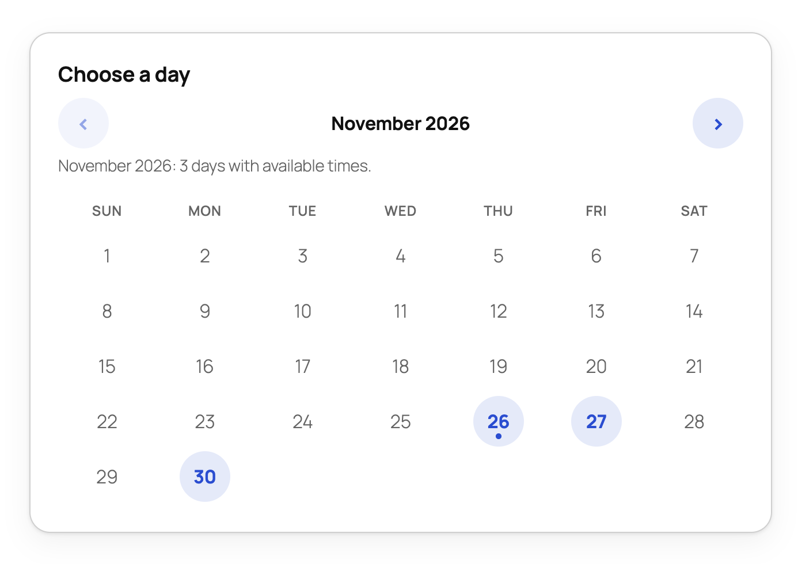
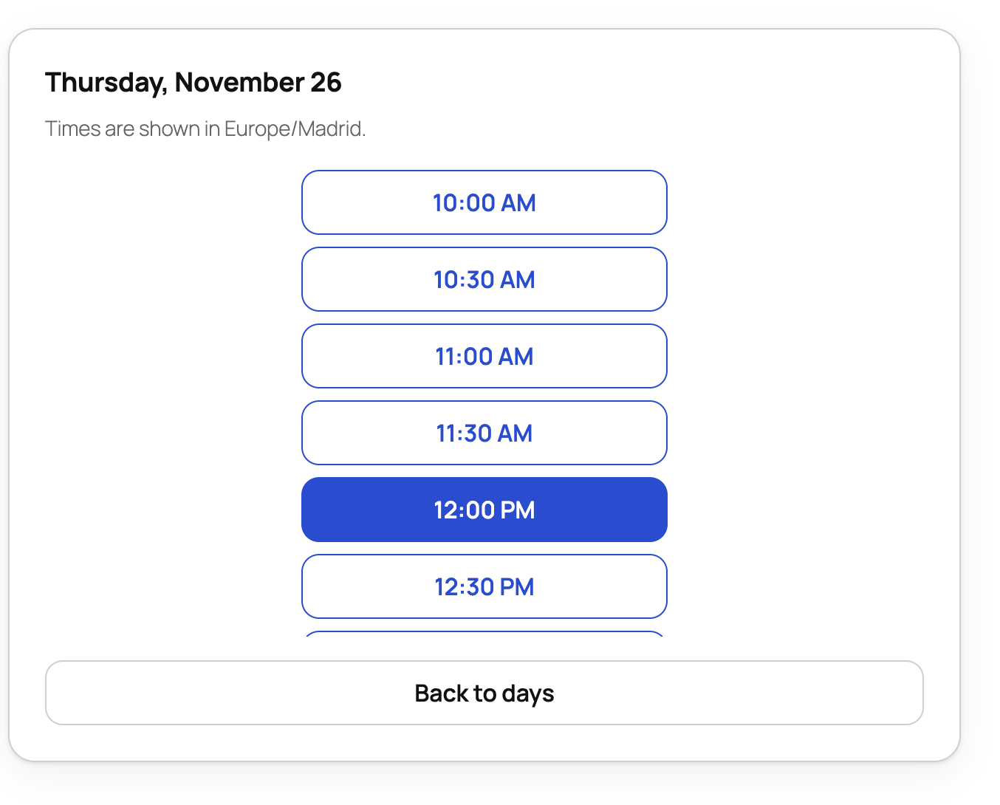

# Hitzordu

Accessible appointment booking for WordPress and static sites. One Vue custom element, a shared PHP core, and a WordPress plugin with its own API: no double bookings, no third-party scheduler.

_Hitzordu_ is Basque for "appointment".

<p>
  
  
</p>

## Why

Third-party scheduling embeds are heavy, hard to style, and keep visitor data on someone else's servers. Hitzordu is a small, self-hosted alternative built to a few hard requirements:

- **Runs inside any theme.** The widget lives in a shadow DOM, so theme CSS can't break it and its CSS can't leak out.
- **Never double books.** Every booking is checked on the server under a database lock, so two visitors can't take the same slot at the same moment.
- **Works by keyboard and screen reader.** The calendar follows the WAI-ARIA grid pattern: one tab stop, arrow key navigation, and spoken status updates.
- **Gets time zones right.** Slots are stored in UTC and shown in each person's own zone, including across daylight saving changes.

## How it fits together

```
hitzordu/
├── packages/
│   ├── core/          PHP library: slot generation and booking rules (no framework)
│   └── widget/        Vue 3 + TypeScript custom element: <hitzordu-widget>
└── plugins/
    └── hitzordu/      WordPress plugin: tables, REST API, emails, admin screens
```

The widget only talks to a small JSON API. The WordPress plugin implements that API today; a Laravel implementation for static sites is planned, reusing the same core library and the same widget unchanged.

## Features

**For visitors**

- Month calendar showing only days with free times, up to two months ahead
- Times shown in the visitor's own time zone and language conventions
- Short booking form, confirmation screen, and confirmation email
- Cancel link in the email, with a confirm step so email scanners can't cancel by opening it

**For site owners**

- Bookings list, working hours editor, and settings in wp-admin
- Notification email for new bookings
- Spam protection: a honeypot field and per-visitor rate limiting
- Restyle the widget with a few CSS custom properties
- Data kept on uninstall unless you choose otherwise

## Requirements

- WordPress 6.5 or newer
- PHP 8.2 or newer
- Composer and Node.js, to build from source

## Getting started (development)

```bash
git clone https://github.com/alessandro-giuzio/hitzordu.git
cd hitzordu

# PHP dependencies (also links the core library into the plugin)
cd plugins/hitzordu && composer install && cd ../..

# Build the widget into plugins/hitzordu/public/js
cd packages/widget && npm install && npm run build && cd ../..

# Link the plugin into a local WordPress site
ln -s "$(pwd)/plugins/hitzordu" /path/to/wordpress/wp-content/plugins/hitzordu
```

Then activate **Hitzordu** in wp-admin. Activation creates the tables and a default 30-minute "Discovery call" with Monday to Friday, 09:00 to 17:00 hours. Set the site's time zone under **Settings → General**, since working hours are read in that zone.

## Usage

Add the shortcode to any page:

```
[hitzordu]
```

Options:

| Attribute | Default          | Purpose                                                |
| --------- | ---------------- | ------------------------------------------------------ |
| `type`    | `discovery-call` | Which meeting type to book                             |
| `contact` | empty            | A URL shown to visitors who have JavaScript turned off |

Manage everything else under **Hitzordu** in the wp-admin menu: **Bookings**, **Working hours**, and **Settings**.

## Theming

Set any of these on the element from your theme's CSS:

```css
hitzordu-widget {
  --hitzordu-accent: #0f766e;
  --hitzordu-radius: 0;
}
```

| Property                     | Default           | Controls                                 |
| ---------------------------- | ----------------- | ---------------------------------------- |
| `--hitzordu-accent`          | `#1d4ed8`         | Selected day, primary button, focus ring |
| `--hitzordu-accent-contrast` | `#ffffff`         | Text on the accent colour                |
| `--hitzordu-radius`          | `0.5em`           | Corner radius                            |
| `--hitzordu-text`            | inherited         | Text colour                              |
| `--hitzordu-muted`           | derived from text | Secondary text                           |
| `--hitzordu-border`          | derived from text | Borders                                  |
| `--hitzordu-font`            | inherited         | Font family                              |
| `--hitzordu-font-size`       | `max(1rem, 16px)` | Base size; everything scales from it     |
| `--hitzordu-max-width`       | `28em`            | Widget width                             |

For deeper changes, style the exposed parts: `hitzordu-widget::part(day)`, `::part(button)` and `::part(input)`.

If you change the accent colour, keep text on it at a contrast ratio of at least 4.5:1.

## API

All routes live under `/wp-json/hitzordu/v1`. Times are UTC instants such as `2027-01-12T08:00:00Z`.

| Method and route                    | Purpose                                                                                       |
| ----------------------------------- | --------------------------------------------------------------------------------------------- |
| `GET /availability?type=&from=&to=` | Free slots between two dates (`YYYY-MM-DD`, at most 62 days)                                  |
| `POST /bookings`                    | Create a booking; repeating a request with the same `idempotencyKey` returns the same booking |
| `POST /bookings/cancel`             | Cancel a booking with its emailed token                                                       |

## Tests

```bash
# PHP core
cd packages/core && composer install && ./vendor/bin/pest

# Widget
cd packages/widget && npm test
```

The PHP tests cover slot generation, including daylight saving changes and overlapping bookings. The widget tests cover calendar maths, keyboard movement, time zone grouping, and the booking flow, including retries and slot conflicts.

## Release zip

```bash
scripts/build-release.sh
```

This tests and builds the widget, installs production Composer dependencies (with a real copy of `packages/core`), checks the result, and writes `dist/hitzordu-<version>.zip`. Upload that file under Plugins, Add New, Upload Plugin. The version is read from the header in `plugins/hitzordu/plugin.php`.

## Status

Working and in active development. Done: the full booking flow, emails, cancellation, spam protection, admin screens, the accessible widget, buffers, minimum notice, booking window and date overrides, a block for the block editor, translations (English, Spanish, Basque and Italian), a compact card design, and an installable release zip.

Planned:

- A Laravel API so the same widget works on static sites

## Built with

[WordPress](https://wordpress.org) · [Vue 3](https://vuejs.org) · [TypeScript](https://www.typescriptlang.org) · [Vite](https://vite.dev) · [Pest](https://pestphp.com) · [Vitest](https://vitest.dev)

## Author

[Alessandro Giuzio](https://www.giuz.io) · [Agency-GA](https://www.agencyga.es)

## License

GPL-2.0-or-later. See [`plugins/hitzordu/LICENSE.txt`](plugins/hitzordu/LICENSE.txt).
